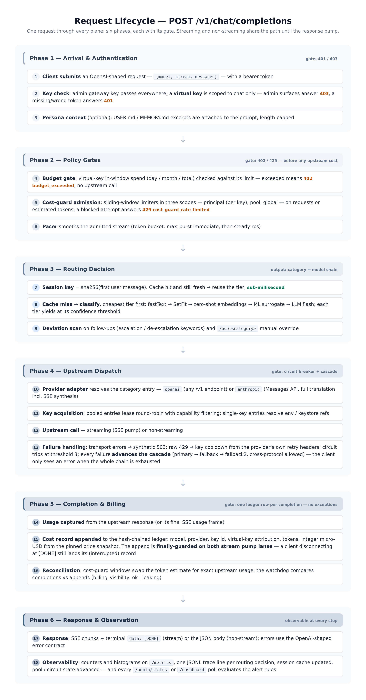
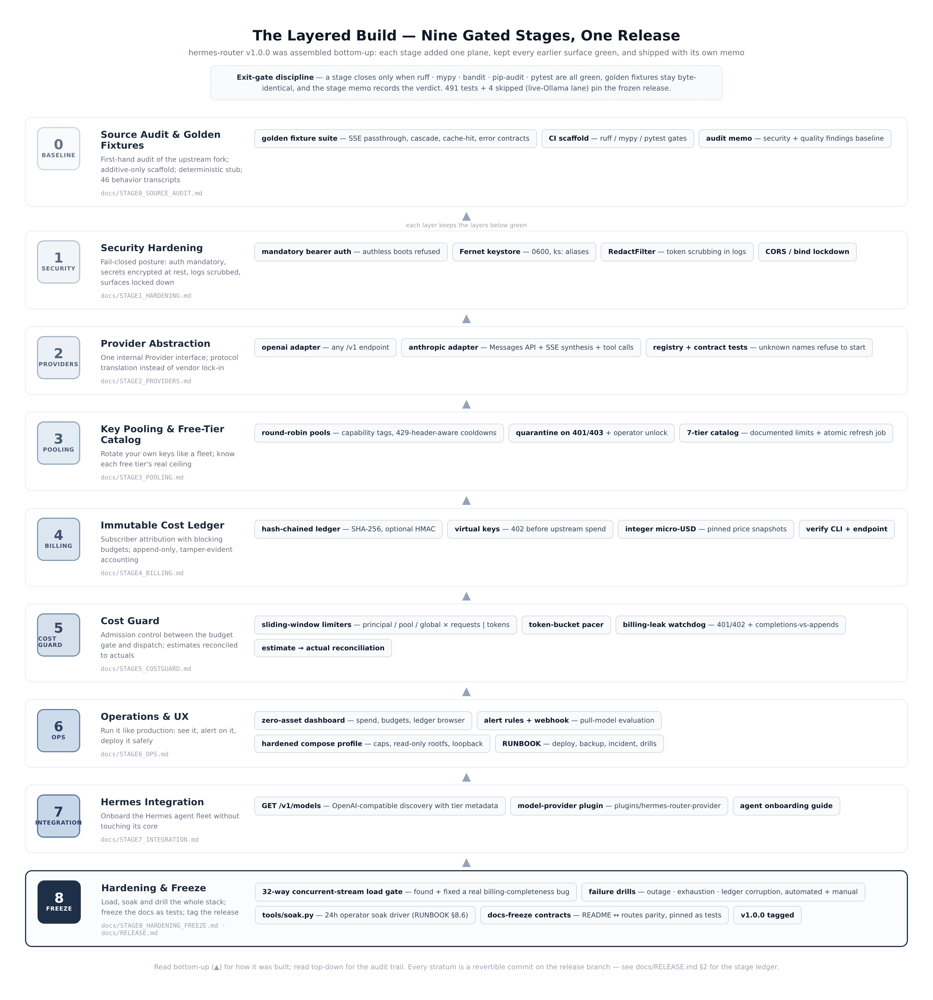

# hermes-router

**A production-hardened, self-hosted LLM gateway.** One OpenAI-compatible endpoint in front of every provider you use: it classifies conversations and routes each one to the right model chain, rotates provider keys, enforces per-subscriber budgets, writes an immutable cost ledger, and watches itself with alerts and a zero-asset dashboard.

[](https://github.com/marktantongco/hermes-router/actions/workflows/ci.yml)
[](#testing--quality-gates)
[](docs/RELEASE.md)
[](pyproject.toml)
[](LICENSE)

Hardened fork of [kjames2001/hermes-router-proxy](https://github.com/kjames2001/hermes-router-proxy) (pinned `0a9560e`), rebuilt through nine exit-gated engineering stages: security hardening, provider abstraction, key pooling, an immutable billing ledger, cost-guard admission control, an operations plane, Hermes integration, and a load/soak/failure-drill freeze — **491 tests + 4 skipped pin the v1.0.0 surface, including 46 byte-stable golden fixtures and the docs themselves.**


## Why

* **Not every query needs your most expensive model** — a flash classifier sends chat to a cheap model and code to a strong one, decided once per session at sub-millisecond cost.
* **Providers fail; your endpoint shouldn't** — per-endpoint circuit breakers, key pools with 429-aware cooldowns, and cross-protocol fallback chains turn outages into a reroute.
* **Spend must be provable** — one hash-chained cost record per completion, integer-exact micro-USD, budgets that block *before* the upstream call (`402`, not an invoice surprise).
* **Self-hosted means self-watched** — dashboard, Prometheus metrics, alert rules with webhooks, and a 24-hour soak driver shipped in the box.

## Contents

* [Quick start](#quick-start) — installer, Docker, or source
* [How it works](#how-it-works) — routing pipeline + request lifecycle
* [Configuration](#configuration) — the full annotated reference
* [API endpoints](#api-endpoints) — the complete surface (parity-tested)
* [Operations](#operations) — dashboard, metrics, alerts
* [Testing & quality gates](#testing--quality-gates)
* [Release v1.0.0](#release-v100-stage-8-freeze) — manifest, soak evidence
* [Documentation](#documentation) — runbook, architecture, walkthrough, stage memos
* [Project layout](#project-layout)
* [Contributing](#contributing) · [Security](#security) · [License](#license)

## Quick start

**Path A — bare metal, the installer (recommended).** Preflight, venv, pinned runtime, config from the annotated example, a generated gateway key, hardened systemd unit, boot verification — one command, idempotent:

```bash
git clone https://github.com/marktantongco/hermes-router.git
cd hermes-router
sudo bash install.sh            # → /opt/hermes-router + systemd (or: --home DIR, --no-service)
bash install.sh doctor          # post-install health report any time
```

**Path B — Docker (hardened compose profile):**

```bash
docker compose config           # validate (structure pinned by tests/test_deploy.py)
docker compose up -d            # loopback bind, caps, read-only rootfs, state volume
curl -fsS localhost:8766/health
```

**Path C — from source (development):**

```bash
python3 -m venv .venv && . .venv/bin/activate
pip install -e ".[dev]"
pytest                          # the full frozen surface, green
python server.py                # auth is MANDATORY — see Configuration
```

**First request** (the gateway key is in `router.env` after an installer run):

```bash
curl -s -H "Authorization: Bearer $ROUTER_PROXY_API_KEY" \
     -H "Content-Type: application/json" \
     -d '{"model":"auto","messages":[{"role":"user","content":"hello!"}]}' \
     http://127.0.0.1:8766/v1/chat/completions
```

Point any OpenAI SDK at `base_url = http://your-host:8766/v1` — that is the entire client-side change. New to the project? The [walkthrough](docs/WALKTHROUGH.md) takes a fresh host to a fully drilled production deployment, step by step.

## Features

- **Smart classification** — a local flash model classifies each new conversation into a task category; follow-ups reuse the cached tier with sub-millisecond keyword deviation detection
- **5-tier classifier ladder (cheapest first)** — fastText (<0.01 ms) → SetFit (~10 ms) → zero-shot embeddings → offline-learned ML surrogate (~0.1 ms, zero LLM cost) → LLM flash fallback; each tier yields at its confidence threshold
- **`/classifier/report` endpoint** — surrogate coverage, confidence distribution, routing stats, hourly drift timeline; `?format=html` for a dark-themed dashboard
- **Session awareness** — classify once per conversation (session key = hash of the first user message), 5-minute TTL, re-classification only on keyword deviation or `/use:<category>` override
- **Provider abstraction (Stage 2)** — `openai` adapter (any `/v1` endpoint: OpenAI, Ollama, vLLM, LM Studio, llama.cpp, …) + `anthropic` adapter (Messages API with full translation, streaming SSE synthesis, tool calls); fallbacks may cross protocols
- **Key pooling (Stage 3)** — round-robin over your own keys with capability tags; 429 cooldowns read from the provider's own retry headers; 401/403 quarantine with operator unlock; a seven-tier free-tier catalog with an atomic refresh job
- **Immutable cost ledger (Stage 4)** — one hash-chained record per completion (SHA-256, optional HMAC), integer micro-USD from pinned price snapshots, virtual keys with blocking budgets (`402` before any upstream spend)
- **Cost guard (Stage 5)** — true sliding-window limiters in principal / pool / global scopes (requests or tokens), estimate-to-actual reconciliation, burst-smoothing pacer, billing-leak watchdog
- **Operations plane (Stage 6)** — zero-asset admin dashboard, six alert rules with webhook delivery, Prometheus metrics, hardened compose profile, full runbook
- **Hermes integration (Stage 7)** — `GET /v1/models` discovery surface plus an optional model-provider plugin
- **Hardening & freeze (Stage 8)** — 32-way concurrent-stream load gate, compressed soak over the failure lattice, three end-to-end failure drills, documentation frozen *as tests*
- **Streaming done right** — transparent SSE passthrough with `[DONE]` handling, usage frames, 503 mid-stream retry, and finally-guarded cost records so a client disconnecting at the last frame still lands its billing row

## How it works

### The request lifecycle



Six phases, each with its gate — authentication, policy (budget + rate windows), routing decision, upstream dispatch with cascade, billing append, response + observation. The full element-by-element reference (purpose and function of every component) is [ARCHITECTURE.md](docs/ARCHITECTURE.md).

### Session lifecycle

```
┌─────────────┐     ┌─────────────┐     ┌──────────────┐
│ "What time  │     │ "Also, can  │     │ "Actually,   │
│  is it?"    │────▶│  you write  │────▶│  write a     │
│ → chat      │     │  me a bash  │     │  deployment  │
│  (cached)   │     │  script?"   │     │  script?"    │
└─────────────┘     │ → keyword   │     │ → keyword    │
                    │   deviation │     │   deviation  │
                    │ → reclass   │     │ → reclass    │
                    │ → code      │     │ → devops     │
                    └─────────────┘     └──────────────┘
```

Sessions expire after a configurable timeout (default: 5 minutes), triggering re-classification on the next message. The model `auto` means "route by classification"; `/use:<category>` forces a category for one message.

### The layered build



Nine gated stages, each a revertible commit with its own memo — the audit trail is [RELEASE.md §2](docs/RELEASE.md). A stage closed only when ruff, mypy, bandit, pip-audit and pytest were all green and the golden fixtures stayed byte-identical.

---

## Configuration

Configuration is a single YAML file (`router_config.yaml`, auto-detected next to `server.py`; hot-reload with `POST /reload`). The complete annotated template is [`router_config.example.yaml`](router_config.example.yaml). Key sections:

### Server

```yaml
server:
  host: "127.0.0.1"     # Stage 1 posture: localhost by default (Dockerfile sets 0.0.0.0)
  port: 8766
```

### Auth (Stage 1 — mandatory, fail-closed)

```yaml
auth:
  mode: required            # the default; 'disabled' is explicit dev-only
  api_key_env: ROUTER_PROXY_API_KEY   # env NAME or ks:<keystore-alias>
```

The server **refuses to boot** with `mode: required` and a missing/unresolvable key. Clients send `Authorization: Bearer <key>`. Virtual keys (`vk-…`, issued via the admin API) may call `/v1/chat/completions` only — every admin surface answers `403 admin_only`. Provider keys live in the encrypted keystore (`python -m keystore`) or env files; logs are scrubbed by a redaction filter.

### Classifier

```yaml
classifier:
  model: "qwen2.5:3b"           # any fast flash model
  base_url: "http://localhost:11434/v1"
  api_key_env: ""               # Ollama doesn't need auth
  session_timeout_minutes: 5    # cache expiry
  system_prompt: "..."          # classification prompt template
  profile_hint: ""              # auto-filled from USER.md + MEMORY.md on first run
  fasttext:  {enabled: false}   # each local tier is independently toggleable
  setfit:    {enabled: false}
  surrogate: {enabled: false}
  zero_shot: {enabled: false}
```

### Categories — your routing table

Any number of task categories; each maps to a model with up to two fallbacks and either a single key (`api_key_env`) or a key pool (`key_pool`). The legacy two-tier `models: simple/complex` format is auto-migrated on load.

```yaml
categories:
  code:
    label: "Code & Debug"
    model: "deepseek-v4-pro"
    base_url: "https://ollama.com/v1"
    api_key_env: "OLLAMA_API_KEY"
    alternate_key_env: ""            # optional — key rotation on 429
    timeout_seconds: 300
    fallback_model: "deepseek-v4-pro"      # optional fallback 1
    fallback_base_url: "https://api.deepseek.com/v1"
    fallback_key_env: "DEEPSEEK_API_KEY"
    fallback2_model: ""               # optional last resort
    fallback2_base_url: ""
    fallback2_key_env: ""
```

### Provider adapters (Stage 2)

| Provider | Protocol | Use for |
|----------|----------|---------|
| `openai` (default) | `/v1/chat/completions` | OpenAI, Ollama, LM Studio, vLLM, llama.cpp, aggregators (aliases: `ollama`, `lmstudio`, `vllm`, `llamacpp`, `openai_compat`) |
| `anthropic` | `/v1/messages` | Anthropic Messages API — full request/response translation, SSE synthesis to OpenAI chunks, tool-call round trips |

```yaml
categories:
  agent:
    provider: anthropic            # adapter selection (fail-closed: unknown names refuse to start)
    model: claude-sonnet-4-5
    base_url: https://api.anthropic.com   # host root — adapter appends /v1/messages
    api_key_env: ANTHROPIC_API_KEY
    max_tokens_default: 8192       # Anthropic requires max_tokens; used when client omits it
    fallback_model: deepseek-v4-pro
    fallback_base_url: https://ollama.com/v1
    fallback_provider: openai      # fallbacks may cross protocols; unset inherits primary
```

Introspect the live registry and per-category resolution at `GET /admin/providers` (auth required). Trace `route` events carry `provider` attribution; non-default providers annotate success responses with `hermes_router.provider`. Adapter limitations (documented in `providers.py`): unsupported OpenAI fields (`n`, `logprobs`, `response_format`, ...) are dropped with a debug log; `tool_choice: "none"` drops tools entirely; images accept data URIs and http(s) URLs.

### Key pools (Stage 3)

A pool rotates several of **your own** keys for one endpoint: round-robin leasing with capability filters, cooldowns on 429 taken from the provider's own retry headers (`Retry-After`, `x-ratelimit-reset`), bounded by policy, quarantine on 401/403 until fixed or operator-unlocked. Inspect live at `GET /admin/pools`; unlock with `POST /admin/pools/{name}/unlock`. See the annotated block in the example config.

```yaml
key_pools:
  free_tier:
    strategy: round_robin
    keys:
      - {ref: GROQ_KEY_1, label: groq-1, capabilities: [fast]}
      - {ref: ks:groq2,  label: groq-2, capabilities: [fast, vision]}

categories:
  chat:
    model: llama-3.3-70b-versatile
    base_url: https://api.groq.com/openai/v1
    key_pool: free_tier
    require_capabilities: [fast]
```

### Billing plane (Stage 4)

Every successful upstream completion becomes **one append-only, hash-chained cost record** in a SQLite (WAL) ledger: model, provider, key attribution (pool key ids), virtual-key attribution, token counts, integer micro-USD costs, and the exact price snapshot used. Records are linked `row_hash = SHA-256(canonical_json(record))` (or HMAC-SHA256 when `hmac_key_env` is set), so field edits, row deletions, and tail truncation are all detectable — `GET /admin/ledger/verify` recomputes the chain live, and `python -m ledger verify` does it offline. Money math is integer-only end to end: prices are stored as nano-USD per million tokens, costs accumulate as micro-USD — no floating-point drift.

**Virtual keys** (`vk-<32 hex>`, plaintext shown once, only the SHA-256 stored) attribute downstream traffic per subscriber. Each request presented with a virtual key is checked **before routing**: if its in-window spend (or token count) reached the budget, the router answers `402 budget_exceeded` and the upstream is never contacted. Virtual keys are inference-only — every admin surface and `/metrics` reject them with `403 admin_only`.

```yaml
ledger:
  enabled: true
  db_path: .router/ledger.sqlite3
  hmac_key_env: ''            # env NAME or ks:<alias> — upgrades the chain to HMAC

pricing:
  default: {input_per_mtok: 0.5, output_per_mtok: 1.5}
  entries:
    glm-4.7: {input_per_mtok: 0.6, output_per_mtok: 2.2}
    local-free-model: {input_per_mtok: 0.0, output_per_mtok: 0.0, free: true}
```

Manage subscribers and inspect spend (admin key required):

```bash
# create (token printed exactly once)
curl -X POST /admin/virtual_keys -H "Authorization: Bearer $ADMIN" \
     -d '{"name": "subscriber-a", "budget_mode": "cost_micros",
          "budget_limit": 5000000, "budget_period": "month"}'
# in-window spend per key
curl /admin/virtual_keys -H "Authorization: Bearer $ADMIN"
# aggregate spend by model / key / session / day
curl "/admin/ledger/summary?group_by=model" -H "Authorization: Bearer $ADMIN"
# tamper evidence
curl /admin/ledger/verify -H "Authorization: Bearer $ADMIN"
```

Ledger failures never break proxying — a failed append is counted (`ledger_append_failures_total`) and alerted, and the request still completes. With `ledger.enabled: false` the whole plane is inert (admin ledger endpoints answer `409 ledger_disabled`).

### Cost guard (Stage 5)

Admission control sits **between the Stage 4 budget gate and upstream dispatch** (a spent budget still reports `402`, not `429`): sliding-window limiters first, then a token-bucket pacer. Rejected requests never reach a provider.

* **Limiters** are true sliding windows in three scopes: `principal` (per virtual key; the gateway admin key is exempt, mirroring the budget gate), `pool` (per key-pool ceiling enforced at the pooled dispatch door — a blocked attempt behaves exactly like pool exhaustion, so the fallback cascade advances behind a synthetic 429), and `global` (every request, admin included). Each limiter sets exactly one dimension: `requests` or `tokens`.
* **Estimate-to-actual reconciliation** — token windows admit a prompt estimate (`chars / estimate_chars_per_token`); when the completion's real usage lands at the ledger choke point, a signed correction swaps the estimate for the actual total, so windows hold exact usage. Pool windows keep the estimate on purpose (each upstream attempt genuinely consumed prompt tokens).
* **Pacer** — `max_burst` immediate admits, then a steady `requests_per_second`, so bursts smooth out instead of tripping provider 429s.
* **Billing-leak watchdog** — upstream `401`/`402` (configurable) are recorded as billing signals; the report cross-checks completions against ledger appends (`billing_visibility: ok | leaking`).

```yaml
cost_guard:
  enabled: true
  estimate_chars_per_token: 4
  limiters:
    - {name: per-key-rpm, scope: principal, requests: 30, window_seconds: 60}
    - {name: per-key-tpm, scope: principal, tokens: 60000, window_seconds: 60}
    - {name: tier-rpd, scope: pool, requests: 14400, window_seconds: 86400}
    - {name: global-safety, scope: global, requests: 600, window_seconds: 60}
  pacer: {requests_per_second: 10, max_burst: 20}
  watchdog: {statuses: [401, 402]}
```

A blocked request returns `429 cost_guard_rate_limited` with the full limiter verdict (limiter, scope, dimension, limit, used, retry hint). Live state — window loads per identity, admits/blocks, pacer waits, watchdog events, reconciliation counters — is one call away at `/admin/costguard` (auth required). Invalid `cost_guard` configuration refuses startup and hot-reload (fail-closed); an absent section disables the guard with zero behavior change.

### Operations plane (Stage 6)

**Dashboard** — `GET /dashboard` (admin key, browser): status cards, active alerts, spend by model / key / day, virtual-key budgets with usage bars, a paginated ledger browser (`?page=N`, `?vk=<id>`), pool availability, circuit states, cost-guard summary and the free-tier catalog on one page. `?refresh=30..3600` adds auto-refresh, `?format=json` returns the exact snapshot the page renders. Zero external assets by design — inline CSS, no CDN, no JavaScript — so it renders in air-gapped browsers and can never leak an admin session to a third-party asset host.

**Alerting** — rule-based alerts evaluated on every dashboard/status/alerts call (pull-model: point your uptime checker at `/admin/status` and that poll *is* the alert heartbeat):

| Rule | Fires when | Severity |
|---|---|---|
| `budget_threshold` | a virtual-key budget is ≥ 80% consumed (warning) or exhausted/blocked (critical) | warning / critical |
| `pool_exhaustion` | a pool has keys but none available | critical |
| `circuit_open` | a circuit breaker is open | warning |
| `billing_leak` | upstream 401/402 observed within the leak window | critical |
| `ledger_append_failures` | ledger writes have failed since boot | critical |
| `ledger_verify` (opt-in, default off) | the hash chain fails verification — O(n) scan, cached by record count | critical |

Transitions fire an optional `webhook_url` exactly once per raise/clear (`{"event": "raised", "alert": {...}}`), fail-soft — delivery failures are counted in `/metrics` and never break a request. Verify the pipe with `POST /admin/alerts/test`.

```yaml
alerts:
  enabled: true
  budget_warn_threshold: 0.8
  billing_leak_window_seconds: 900
  rules: {budget_threshold: true, pool_exhaustion: true, circuit_open: true,
          billing_leak: true, ledger_append_failures: true, ledger_verify: false}
  webhook_url: ""              # optional http(s) target
```

### Circuit breaker

```yaml
circuit_breaker:
  failure_threshold: 3       # failures within the window before tripping
  recovery_timeout_sec: 30   # how long the circuit stays open
  window_sec: 60             # sliding window for counting failures
```

### Routing keywords

```yaml
routing:
  escalation_keywords:
    - implement - debug - deploy - configure - fix
    - error - script - code - automation - server
  de_escalation_keywords:
    - thanks - thank - lol - ok - cool - nice
    - good morning - how are you - hello - hi
  override_prefix: "/use:"
```

### Persona (reads both USER.md + MEMORY.md)

```yaml
persona:
  user_path: "~/.hermes/USER.md"      # who the user is
  memory_path: "~/.hermes/MEMORY.md"  # durable facts & rules
  max_context_chars: 800              # max chars read for hint extraction
```

### Environment variables

| Variable | Purpose | Default |
|---|---|---|
| `ROUTER_PROXY_API_KEY` | The gateway auth key (name is set by `auth.api_key_env`) | required, fail-closed |
| `LOG_FORMAT` | Set to `json` for structured JSON logging | plain text |
| `CORS_ORIGINS` | Comma-separated allow-list (off / same-origin by default; a wildcard drops credentials) | off |
| `TRACE_LOG_DIR` | Directory for JSONL trace files | `./traces` |
| `TRACE_LOG_MAX_BYTES` | Max bytes per trace file before rotation | `10485760` (10 MB) |
| `TRACE_LOG_BACKUPS` | Number of rotated trace files to keep | `5` |
| `TRACE_LOG_ENABLED` | Set to `false` or `0` to disable trace logging | `true` |
| `ROUTER_HOST` | Override the config bind address (the Dockerfile sets `0.0.0.0`) | config value |

---

## API endpoints

The complete surface (this table is parity-tested against the live route registry in both directions — `tests/test_freeze.py`):

| Endpoint | Method | Auth | Description |
|---|---|---|---|
| `/v1/chat/completions` | POST | Optional | OpenAI-compatible chat completions (routed) |
| `/v1/models` | GET | Required | OpenAI-compatible model listing: every routable upstream model (primary + fallbacks), deduplicated, with tier metadata (Stage 7) |
| `/health` | GET | None | Liveness check + active session count |
| `/metrics` | GET | Required | Prometheus-compatible metrics |
| `/reload` | POST | Required | Hot-reload `router_config.yaml` without restart |
| `/admin/sessions` | GET | Required | List all cached sessions with tier + age |
| `/admin/sessions/{key}` | DELETE | Required | Force-evict a cached session |
| `/admin/config` | GET | Required | Show live config (env var names only, no secrets) |
| `/admin/providers` | GET | Required | Provider registry + per-category adapter resolution (Stage 2) |
| `/admin/pools` | GET | Required | Key-pool state: keys, counters, cooldowns (Stage 3) |
| `/admin/pools/{name}/unlock` | POST | Required | Lift a quarantine/cooldown on a pooled key (Stage 3) |
| `/admin/catalog` | GET | Required | Free-tier catalog snapshot + refresh status (Stage 3) |
| `/admin/catalog/refresh` | POST | Required | Pull a fresh catalog (opt-in remote) (Stage 3) |
| `/admin/virtual_keys` | POST | GET | Required | Create / list subscriber virtual keys with in-window spend (Stage 4) |
| `/admin/virtual_keys/{id}` | PATCH | DELETE | Required | Update budget/enabled / revoke a virtual key (Stage 4) |
| `/admin/ledger/verify` | GET | Required | Recompute the full hash chain — tamper evidence (Stage 4) |
| `/admin/ledger/records` | GET | Required | Recent cost records; `?virtual_key_id=` filters per subscriber (Stage 4) |
| `/admin/ledger/summary` | GET | Required | Aggregate spend: `?group_by=model\|key\|session\|day` (Stage 4) |
| `/admin/costguard` | GET | Required | Cost-guard snapshot: limiters, window loads, pacer, watchdog, reconciliation (Stage 5) |
| `/dashboard` | GET | Required | Operations dashboard: status, spend, budgets, ledger browser, alerts — `?format=json`, `?page=N`, `?vk=`, `?refresh=` (Stage 6) |
| `/admin/status` | GET | Required | Light JSON status for monitoring polls; each poll drives alert evaluation (Stage 6) |
| `/admin/alerts` | GET | Required | Evaluate alert rules now: active alerts, history, config echo (Stage 6) |
| `/admin/alerts/test` | POST | Required | Push a synthetic event through the webhook pipe (Stage 6) |
| `/circuits` | GET | Required | List all circuit breaker states |
| `/circuits/reset` | POST | Required | Reset all circuit breakers to closed |
| `/classifier/report` | GET | Required | Surrogate coverage, confidence distribution, routing stats, drift timeline. `?format=html` for dark-themed dashboard |

Authentication: send the gateway key (or a virtual key, for chat-only) as `Authorization: Bearer <token>`. Unauthenticated calls to protected surfaces get `401`; virtual keys on admin surfaces get `403 admin_only`.

---

## Point Hermes at it

The full onboarding guide — both integration paths, model naming rules, virtual-key attribution, the streaming/tool-calling contract, the local Ollama lane and troubleshooting — lives in [`docs/HERMES_INTEGRATION.md`](docs/HERMES_INTEGRATION.md). The short form (Path A, `custom_providers`):

In `~/.hermes/config.yaml`:

```yaml
model:
  default: deepseek-v4-pro          # primary model — router proxies to this or fallback
  provider: auto-router             # routes through the proxy

custom_providers:
- name: auto-router
  base_url: http://localhost:8766/v1
  model: deepseek-v4-pro            # must match one of the configured tier models

fallback_providers:                 # gateway-level, fires if the router itself is unreachable
- provider: nous
  model: qwen/qwen3.6-plus
```

Then restart the Hermes gateway. Want the agent's model picker to list every routable gateway model (with tier structure) instead of one hard-coded name? Install the optional model-provider plugin:

```bash
mkdir -p ~/.hermes/plugins
cp -r plugins/hermes-router-provider ~/.hermes/plugins/
echo "HERMES_ROUTER_API_KEY=vk-..." >> ~/.hermes/.env   # virtual key recommended
hermes gateway restart
```

See [`plugins/hermes-router-provider/README.md`](plugins/hermes-router-provider/README.md) for the pinned contract, configuration and verification steps.

---

## Docker deployment

```bash
docker build -t hermes-router:latest .

docker run -d --name hermes-router --restart unless-stopped \
  -p 127.0.0.1:8766:8766 \
  -v /path/to/router_config.yaml:/app/router_config.yaml:ro \
  --env-file /path/to/router.env \
  hermes-router:latest
```

The repo ships a hardened compose profile (`docker-compose.yaml`): loopback-only port mapping (`127.0.0.1:8766:8766` — widen explicitly if you mean to), 512 MB / 1 CPU caps with swap disabled, a stdlib `/health` healthcheck, `no-new-privileges`, all capabilities dropped, a read-only rootfs, size-capped logs, and a named `router-state` volume so the ledger, keystore and traces survive redeploys. Its structure is pinned by `tests/test_deploy.py`. The default image carries `router_config.example.yaml` — mount your real config to override; the env file needs your provider keys and the gateway key.

---

## Monitoring

### Plain text (default)

```
2026-10-12 09:00:01 | INFO | 127.0.0.1:52318 | POST /v1/chat/completions | 200 | 184ms | model=deepseek-v4-pro tier=code cached=False
```

### JSON (`LOG_FORMAT=json`)

Structured logs with request id, latency, model, tier, cache state — ready for any log shipper.

### Metrics (`GET /metrics`, Prometheus text)

Request and error counters per category, stream totals, pool leases and cooldowns, circuit states, cost-guard admits/blocks, ledger appends, alert firings, webhook deliveries.

### Trace logging (JSONL)

Every routing decision — classification, cache hit, deviation, fallback, breaker transition — as one JSON line in `traces/`, size-capped and rotated:

```bash
jq 'select(.event=="classification") | .tier' traces/*.jsonl | sort | uniq -c   # tier distribution
jq 'select(.event=="fallback") | .from_model' traces/*.jsonl | sort | uniq -c  # fallback frequency
```

---

## Testing & quality gates

The release bar is the same stack CI enforces (`.github/workflows/ci.yml`):

```bash
ruff check .                 # 0 findings (E4/E7/E9/F + documented ratchets)
mypy server.py providers.py trace.py keystore.py keypool.py catalog.py \
      ledger.py costguard.py alerts.py dashboard.py surrogate_models.py   # 0 errors
bandit -r . -ll              # 0 issues on the runtime surface
pip-audit -r requirements-audit.txt        # clean, pinned closure
pytest                       # 491 passed, 4 skipped (live-Ollama lane)
```

What the suite pins, beyond unit behavior:

* **46 golden fixtures** — byte-stable transcripts of the unmodified gateway against a deterministic stub, re-captured and diffed at every stage boundary (`tests/test_golden_fixtures.py`)
* **Load / soak** — `tests/test_load_soak.py`: 32-way concurrent streaming with exact one-ledger-row-per-request billing (this gate found and fixed a real billing-completeness bug), plus a compressed soak over the rotation/exhaustion/recovery lattice
* **Failure drills** — `tests/test_failure_drills.py`: provider outage, key exhaustion and ledger corruption, end to end, including the backup/restore procedure
* **Deploy contracts** — `tests/test_deploy.py`: the compose profile and systemd unit structure
* **Freeze contracts** — `tests/test_freeze.py`: README endpoint parity (both directions), RUNBOOK coverage, RELEASE structure, version consistency — the documentation itself is tested

## Release v1.0.0 (Stage 8 freeze)

The D2 v1 plan (Stages 0–8) is complete and frozen; the release manifest is [`docs/RELEASE.md`](docs/RELEASE.md) (gate results, the risk-register re-score, known limitations, and the resolved root LICENSE decision — MIT, dual-attribution with the upstream).

Stage 8 added the hardening plane:

* **Load / soak** — `tests/test_load_soak.py` pins exact billing under 32-way concurrent streaming (it found and closed a real billing-completeness gap: streams cancelled at the final `[DONE]` frame could skip their cost record), plus a deterministic compressed soak over the rotation/exhaustion/recovery lattice.
* **Failure drills** — `tests/test_failure_drills.py` drills the three dossier lifecycles end-to-end: provider outage (circuit → cascade → alert → half-open recovery → manual reset), key exhaustion (cooldowns → synthetic 429 cascade → alert → unlock), and ledger corruption + the R9 backup/restore procedure. Manual rehearsal procedures: [RUNBOOK §8](docs/RUNBOOK.md).
* **24-hour soak driver** — `tools/soak.py` (stdlib-only):

  ```bash
  python tools/soak.py --url http://127.0.0.1:8766 --key "$ROUTER_PROXY_API_KEY" \
      --duration 24h --concurrency 24 --report soak_$(date +%F)
  ```

All golden fixtures (46) re-verified byte-identical at freeze; the full gate stack is green. Release soak evidence: [docs/soak/README.md](docs/soak/README.md).

---

## Documentation

| Document | What it covers |
|---|---|
| [Walkthrough](docs/WALKTHROUGH.md) | zero to production, step by step (also the GitHub wiki) |
| [Architecture](docs/ARCHITECTURE.md) | every element — purpose and function, with diagrams |
| [Runbook](docs/RUNBOOK.md) | deploy, key rotation, backup/restore, incidents, drills, the 24h soak |
| [Release manifest](docs/RELEASE.md) | v1.0.0 gates, stage ledger, risk re-score, known limitations |
| [Hermes integration](docs/HERMES_INTEGRATION.md) | onboarding the agent: custom providers + plugin |
| Stage memos | `docs/STAGE0_SOURCE_AUDIT.md` … `docs/STAGE8_HARDENING_FREEZE.md` — the engineering record |
| Soak evidence | `docs/soak/` — reports from the release soak runs |

## Project layout

```
server.py                 the gateway (FastAPI) — routing, gates, dispatch, billing, ops
providers.py              Stage 2 provider adapters (openai / anthropic)
keypool.py                Stage 3 key pools (rotation, cooldowns, capabilities)
catalog.py                Stage 3 free-tier catalog (+ catalog/free_tiers.yaml)
ledger.py                 Stage 4 immutable cost ledger + virtual keys
costguard.py              Stage 5 admission control (limiters, pacer, watchdog)
alerts.py                 Stage 6 alert rules + webhook
dashboard.py              Stage 6 zero-asset dashboard
keystore.py               Stage 1 encrypted key store (Fernet)
trace.py                  JSONL routing-trace logging
surrogate_models.py       classifier surrogate + vectorizer classes
zero_shot_classifier.py   zero-shot embedding tier
fasttext_classifier.py    fastText tier
setfit_classifier.py      SetFit tier
tools/soak.py             Stage 8 operator soak driver (stdlib-only)
tools/capture_golden.py   golden fixture capture harness
tests/                    491 tests: golden fixtures, billing, drills, load/soak, freeze contracts
plugins/hermes-router-provider/   Stage 7 model-provider plugin
docs/                     runbook, architecture, walkthrough, release, stage memos
router_config.example.yaml        the fully annotated configuration template
install.sh                the ultimate installer (install / doctor / uninstall)
docker-compose.yaml       hardened container profile
```

## Contributing

The project runs on exit gates — keep them green:

1. Fork, branch, make your change (runtime changes likely ripple the golden fixtures — re-capture with `tools/capture_golden.py` and diff deliberately)
2. Run the full gate stack (`ruff`, `mypy`, `bandit`, `pip-audit`, `pytest`) — CI runs exactly this
3. Documentation changes are code: the freeze contracts in `tests/test_freeze.py` pin README/RUNBOOK/RELEASE structure
4. Open a PR describing which plane your change touches and how you verified the gates

## Security

* Mandatory bearer auth; authless boots refuse to start (Stage 1 posture)
* Provider keys encrypted at rest (Fernet, 0600); master key env-only; logs scrubbed
* CORS off by default; localhost bind by default; the container exposes only what you map
* Admin surfaces require the gateway key; virtual keys are chat-only
* Reporting: open a private security advisory on GitHub rather than a public issue

## License

[MIT](LICENSE) — dual attribution: the upstream work by James Huang ([hermes-router-proxy](https://github.com/kjames2001/hermes-router-proxy), pinned `0a9560e`) and this hardened fork. Every file header has claimed MIT since Stage 0; the root license makes the grant explicit.

## Acknowledgements

* **James Huang + Jarvis** — the original hermes-router-proxy: the routing core, the classifier ladder idea and the transparent streaming proxy this project hardened
* The Hermes ecosystem dossiers that shaped the stage plan — the clean-room protocol kept the billing plane free of AGPL contamination (risk R4, re-scored at release)

