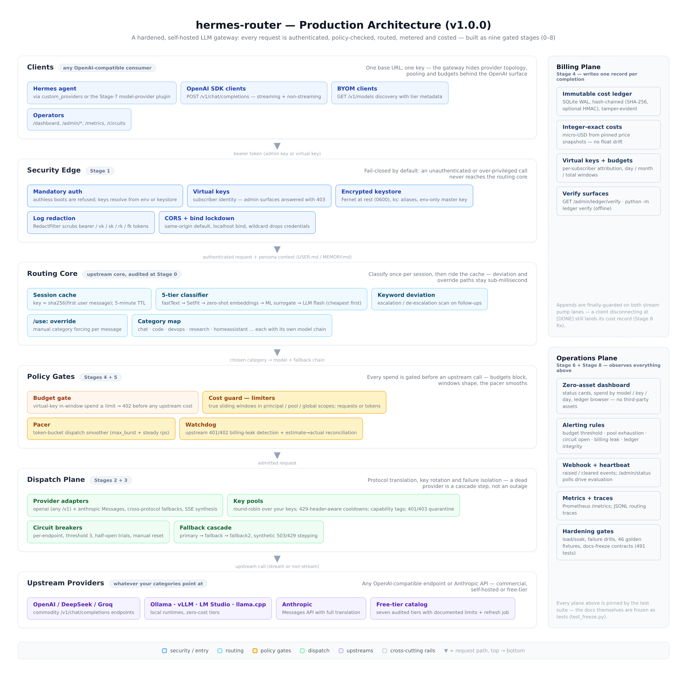

# Walkthrough — zero to production, step by step

This guide takes a fresh host to a production-hardened hermes-router
deployment. Every step explains **what you are doing and why**; the
reference detail behind each step lives in
[ARCHITECTURE.md](ARCHITECTURE.md) (element by element) and the
[RUNBOOK](RUNBOOK.md) (operations).

*Time budget: ~20 minutes to first request; ~1 hour to a fully
drilled, soaked production posture.*

---

## 0. What you are deploying

hermes-router is a **self-hosted LLM gateway**: one OpenAI-compatible
endpoint in front of many providers. It classifies each conversation
into a task category and routes it to the right model chain, rotates
your provider keys, enforces per-subscriber budgets, writes an
immutable cost ledger, and watches itself with alerts and a dashboard.



Why each plane exists:

* **Security edge** — nothing reaches the router without a valid key;
  provider keys live encrypted at rest, logs are scrubbed.
* **Routing core** — cheap model for chat, strong model for code,
  decided per session at sub-millisecond cost after the first message.
* **Policy gates** — budgets and rate windows block spend *before* an
  upstream call, not on the next invoice.
* **Dispatch** — providers, key pools, circuit breakers and fallback
  chains turn "provider down" into a reroute.
* **Billing** — one tamper-evident cost record per completion.
* **Operations** — dashboard, alerts, metrics, and a soak driver.

## 1. Prerequisites

| Need | Why | Check |
|---|---|---|
| Linux host, 1 GB RAM free | gateway + ledger | `free -m` |
| Python ≥ 3.12 | runtime | `python3 --version` |
| (or) Docker + compose | container path | `docker compose version` |
| One provider credential | any OpenAI-compatible or Anthropic key | — |
| 10 minutes of thought | your categories and budgets | — |

## 2. Install

### Path A — bare metal with the installer (recommended)

```bash
git clone https://github.com/marktantongco/hermes-router.git
cd hermes-router

sudo bash install.sh          # /opt/hermes-router + systemd unit
# or, without root:
bash install.sh --home ~/.hermes-router --no-service
```

The installer, in order: preflight (python, venv, openssl, port),
creates a dedicated virtualenv with the pinned runtime, stages the 14
frozen runtime modules plus `tools/` and the free-tier catalog,
creates `router_config.yaml` from the example **(never overwrites an
existing one)**, generates `router.env` (mode 0600) with a fresh
gateway key, installs the hardened systemd unit, and verifies
`/health` plus admin auth. It is idempotent — re-running refreshes
code and preserves your config, keys and ledger.

Verify and diagnose any time:

```bash
bash install.sh doctor        # config parses, key resolvable, ledger verifies, disk
```

### Path B — Docker

```bash
docker compose up -d          # hardened profile: caps, read-only rootfs, loopback bind
curl -fsS localhost:8766/health
```

The compose profile is pinned by 14 structural tests (`tests/test_deploy.py`):
loopback-only port mapping, 512 MB / 1 CPU caps, stdlib healthcheck,
least privilege, and a named volume so ledger, keystore and traces
survive redeploys.

### Path C — from source (development)

```bash
python3 -m venv .venv && . .venv/bin/activate
pip install -e ".[dev]"
pytest            # 491 passed, 4 skipped = the frozen surface, green
python server.py
```

## 3. Configure — anatomy of `router_config.yaml`

Open `$HOME/router_config.yaml` (created from
`router_config.example.yaml`). Work through it top to bottom; each
block below says what it controls and what happens if you get it
wrong (the gateway is fail-closed — bad config refuses to boot, it
never silently degrades).

**a) `auth` — who may call you.**

```yaml
auth:
  mode: required            # the default; 'disabled' is dev-only
  api_key_env: ROUTER_PROXY_API_KEY
```

The named variable must exist in `router.env` (the installer already
generated it). The gateway refuses to boot with `mode: required` and
an unresolvable key — that is deliberate.

**b) `classifier` — the category decider.** Point `base_url` at a
fast, cheap model (a local Ollama flash model is ideal). The five
local tiers (fastText / SetFit / zero-shot / surrogate / LLM) are
individually toggleable; disabled tiers cost nothing. If the
classifier is unreachable, requests still route — to the cheapest
local tier, never to an unconfigured upstream.

**c) `categories` — your routing table.** Each category maps a task
type to a primary model plus up to two fallbacks, and either
`api_key_env` (single key) or `key_pool` (rotation). Start with two:

```yaml
categories:
  chat:
    label: "Chat & Trivia"
    model: deepseek-v4-flash
    base_url: https://ollama.com/v1
    api_key_env: OLLAMA_API_KEY
    timeout_seconds: 120
  code:
    label: "Code & Debug"
    model: deepseek-v4-pro
    base_url: https://ollama.com/v1
    api_key_env: OLLAMA_API_KEY
    fallback_model: deepseek-v4-pro
    fallback_base_url: https://api.deepseek.com/v1
    fallback_key_env: DEEPSEEK_API_KEY
```

Cross-protocol fallback works: an `anthropic` primary can fall back to
an `openai` endpoint (set `fallback_provider` explicitly).

**d) `key_pools` — rotation over your own free-tier keys (optional).**
Two or more keys per provider, round-robin, 429-aware cooldowns read
from the provider's own retry headers. With `require_capabilities`
you can reserve a vision-capable key for the categories that need it.

**e) `ledger` + `pricing` — the billing truth.** `enabled: true`
appends one hash-chained record per completion. Prices are integer
USD-per-million-token entries; models not listed use `default`;
`free: true` tiers record tokens at zero cost. Set `hmac_key_env` to
make the chain tamper-proof (not just tamper-evident).

**f) `cost_guard` — admission control (optional but recommended).**
Sliding windows in three scopes (per virtual key, per pool, global) on
requests or tokens, a burst-smoothing pacer, and the billing-leak
watchdog. An absent section disables the guard entirely.

**g) `alerts` — self-monitoring.** Budget thresholds, pool exhaustion,
open circuits, billing leaks, ledger integrity — evaluated on every
`/dashboard`, `/admin/status` or `/admin/alerts` call, so your uptime
checker's polling cadence drives alerting. Add `webhook_url` to have
raised/cleared events delivered.

Apply changes without downtime:

```bash
curl -X POST -H "Authorization: Bearer $ROUTER_PROXY_API_KEY" \
     http://127.0.0.1:8766/reload
```

## 4. First requests

```bash
KEY=...   # ROUTER_PROXY_API_KEY from router.env

# liveness + sessions
curl -s http://127.0.0.1:8766/health

# what can I call? (OpenAI-compatible discovery)
curl -s -H "Authorization: Bearer $KEY" http://127.0.0.1:8766/v1/models | head

# a routed chat completion (category picked by the classifier)
curl -s -H "Authorization: Bearer $KEY" -H "Content-Type: application/json" \
     -d '{"model":"auto","messages":[{"role":"user","content":"hello!"}]}' \
     http://127.0.0.1:8766/v1/chat/completions

# streaming — same body with "stream": true
curl -N -H "Authorization: Bearer $KEY" -H "Content-Type: application/json" \
     -d '{"model":"auto","stream":true,"messages":[{"role":"user","content":"write a haiku"}]}' \
     http://127.0.0.1:8766/v1/chat/completions

# force a category for one message
curl -s -H "Authorization: Bearer $KEY" -H "Content-Type: application/json" \
     -d '{"model":"auto","messages":[{"role":"user","content":"/use:code fix this regex"}]}' \
     http://127.0.0.1:8766/v1/chat/completions
```

Any OpenAI SDK works by pointing `base_url` at the gateway and
`api_key` at your gateway key — that is the whole client-side change.

## 5. Subscribers: virtual keys and budgets

Give every person/app/agent its own identity instead of sharing the
admin key:

```bash
# create — the token is printed exactly once
curl -s -X POST -H "Authorization: Bearer $KEY" -H "Content-Type: application/json" \
     -d '{"name":"alice","budget_mode":"cost_micros","budget_limit":5000000,"budget_period":"month"}' \
     http://127.0.0.1:8766/admin/virtual_keys

# list with in-window spend
curl -s -H "Authorization: Bearer $KEY" http://127.0.0.1:8766/admin/virtual_keys

# tighten, or revoke
curl -s -X PATCH -H "Authorization: Bearer $KEY" -H "Content-Type: application/json" \
     -d '{"budget_limit":2000000}' http://127.0.0.1:8766/admin/virtual_keys/<id>
curl -s -X DELETE -H "Authorization: Bearer $KEY" http://127.0.0.1:8766/admin/virtual_keys/<id>
```

What happens when Alice runs out: her very next request returns
`402 budget_exceeded` **before any upstream call** — the spend was
blocked, not billed. Her key cannot touch `/admin/*` or `/metrics`
(403). Watch the 80% warning arrive via your alert webhook.

## 6. Money: the ledger

```bash
# recent records (Alice's slice)
curl -s -H "Authorization: Bearer $KEY" \
     "http://127.0.0.1:8766/admin/ledger/records?virtual_key_id=<vk>&limit=5"

# aggregates
curl -s -H "Authorization: Bearer $KEY" \
     "http://127.0.0.1:8766/admin/ledger/summary?group_by=model"

# integrity — recomputes the whole hash chain
curl -s -H "Authorization: Bearer $KEY" http://127.0.0.1:8766/admin/ledger/verify
```

Every record carries model, provider, key id, virtual-key
attribution, token counts, integer micro-USD costs and the price
snapshot used. Back it up on a schedule (RUNBOOK §6 — one sqlite
command plus a copy); restore and verify is a rehearsed drill, not a
hope.

## 7. Operations: see it, alert on it

* **Dashboard** — `http://127.0.0.1:8766/dashboard` (admin key):
  status cards, spend by model/key/day, budget bars, a paginated
  ledger browser, pool and circuit state. Zero third-party assets —
  it renders air-gapped.
* **Metrics** — `GET /metrics` in Prometheus text format: request and
  error counters per category, stream totals, pool and circuit state,
  cost-guard blocks, ledger appends, alert firings.
* **Status poll** — point any uptime checker at `/admin/status`
  (light JSON). Each poll also evaluates all alert rules — this is
  the intended production heartbeat.
* **Webhook** — set `alerts.webhook_url` and raised/cleared events
  arrive as `POST {event, alert}` — exactly once per transition,
  fail-soft.

## 8. Rehearse the failures (RUNBOOK §8)

Three drills, each automated in `tests/test_failure_drills.py` and
rehearsable by hand:

1. **Provider outage** — stop a provider: transport errors become
   synthetic 503s, the circuit opens at threshold 3, the cascade
   reroutes, `circuit_open` alert fires. Revive the provider; a
   half-open trial closes the circuit. Manual reset:
   `POST /circuits/reset`.
2. **Key exhaustion** — burn a pool until every key cools:
   `pool_exhausted` synthetic 429, cascade advances, critical alert.
   Unlock early: `POST /admin/pools/<name>/unlock`.
3. **Ledger corruption** — back up, stop, tamper with the sqlite
   file, restart: boot-time detection alerts, `/admin/ledger/verify`
   names `first_bad_seq`, restore from backup, chain green again.

Run the automated versions any time: `pytest tests/test_failure_drills.py -v`.

## 9. Soak before you trust it (RUNBOOK §8.6)

Before every release tag (and quarterly), run the operator soak —
stdlib-only, safe on the deployed host:

```bash
python tools/soak.py --url http://127.0.0.1:8766 \
    --key "$ROUTER_PROXY_API_KEY" --duration 24h --concurrency 24 \
    --report soak_$(date +%F)
echo "exit=$?"    # 0 = PASS
```

The driver sends sustained mixed traffic (70% streaming) with unique
markers, reassembles every stream client-side (half-reads and
cross-stream corruption count as errors), samples the alerting
heartbeat, and writes JSON + Markdown reports. **PASS = zero 5xx,
error rate within `--max-error-rate`, zero incomplete bodies.** File
both reports with your release evidence.

## 10. Onboard a Hermes agent

* **Custom provider** (no agent changes beyond config):
  add to `~/.hermes/config.yaml`:

  ```yaml
  custom_providers:
    - name: auto-router
      base_url: http://<gateway-host>:8766/v1
      model: auto
  ```

* **Model-provider plugin** (richer): drop
  `plugins/hermes-router-provider/` into the agent and let it
  discover models via `GET /v1/models`. Full guide:
  [HERMES_INTEGRATION.md](HERMES_INTEGRATION.md).

## 11. Troubleshooting quick table

| Symptom | Meaning | Do this |
|---|---|---|
| Boot fails: auth key unresolvable | fail-closed posture working | check `router.env` defines the `api_key_env` name; `install.sh doctor` |
| `401` on every call | missing/wrong bearer | use the gateway key, not a provider key |
| `403` on `/admin/*` | you used a virtual key | virtual keys are chat-only by design |
| `402 budget_exceeded` | the budget gate fired | raise the budget or wait for the window |
| `429 cost_guard_rate_limited` | a sliding window tripped | see which limiter in the response detail; resize it |
| All requests 503 | whole fallback chain exhausted | `GET /circuits`, revive providers or extend chains |
| `pool_exhausted` 429s | every pooled key cooling | `GET /admin/pools`, wait or `unlock` |
| Ledger verify fails | corruption (or a lost HMAC key) | RUNBOOK §7 procedure — restore from backup |
| Dashboard empty | nothing routed yet, or auth | make one chat call; check the admin key |

## 12. Where to go next

* [README](../README.md) — the full surface, endpoint table, config reference
* [ARCHITECTURE.md](ARCHITECTURE.md) — every element, purpose and function
* [RUNBOOK](RUNBOOK.md) — deploy, backup, incidents, drills, soak
* [RELEASE.md](RELEASE.md) — the v1.0.0 manifest: gates, risk re-score, known limitations
* Stage memos `docs/STAGE{0..8}_*.md` — the engineering record, stage by stage
